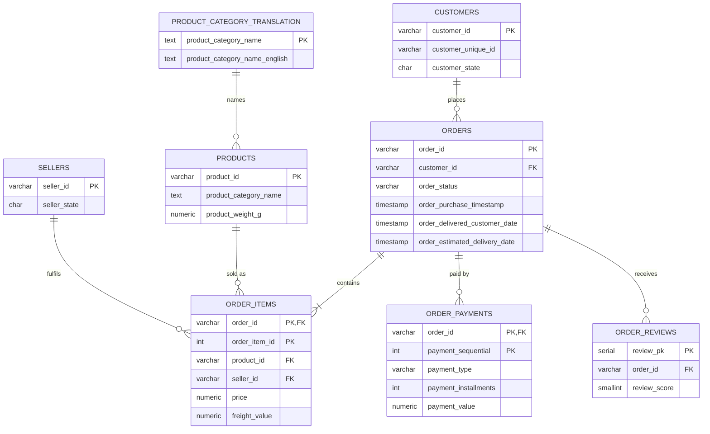

# 🛒 E-Commerce Analytics Deep-Dive with SQL (Olist, PostgreSQL)

An end-to-end SQL analysis of **~100,000 real orders** from Olist, a Brazilian e-commerce marketplace (2016–2018). The project answers business questions about growth, customer retention, delivery performance, seller quality and payments, and turns the answers into recommendations.

**Tools:** PostgreSQL 14+ · psql · dbdiagram.io / Mermaid (ER diagram)

---

## 📌 Business Problem

Olist connects small sellers to big Brazilian marketplaces. Management wants to know:

1. **Growth:** How fast are orders and revenue growing, and when do customers shop?
2. **Customers:** Do customers come back? Which customer segments matter most?
3. **Delivery:** How reliable is delivery, and how much does a late delivery hurt reviews?
4. **Sellers:** Is revenue concentrated in a few sellers? Which sellers are a risk?
5. **Payments:** How do customers pay, and do instalments drive bigger orders?
6. **Products:** Which categories drive revenue, which are growing, and which disappoint customers?

---

## 🗂️ Dataset

[Brazilian E-Commerce Public Dataset by Olist](https://www.kaggle.com/datasets/olistbr/brazilian-ecommerce) on Kaggle: 9 related tables covering orders, items, customers, sellers, products, payments, reviews and geolocation. See [`data/README.md`](data/README.md) for the file list.

### Entity-Relationship Diagram



---

## 📁 Project Structure

```
olist-sql-analysis/
├── data/                        # Kaggle CSVs go here (git-ignored)
├── sql/
│   ├── 00_schema.sql            # Tables, keys, constraints, indexes
│   ├── 01_load_data.sql         # Loads all 9 CSVs with \copy
│   ├── 02_data_quality.sql      # 10 data checks before analysis
│   ├── 03_views_functions.sql   # Reusable view + 2 SQL functions
│   └── analysis/
│       ├── 01_sales_trends.sql
│       ├── 02_customer_analysis.sql
│       ├── 03_delivery_performance.sql
│       ├── 04_seller_analysis.sql
│       ├── 05_payments.sql
│       └── 06_product_analysis.sql
├── results/                     # Saved output of every query (real results)
├── insights.md                  # Findings and recommendations
└── run_all.sh                   # One command to build and run everything
```

---

## ▶️ How to Run

1. Install PostgreSQL 14 or newer.
2. Download the dataset and put the 9 CSVs in `data/`.
3. Create the database and run everything from the repo root:

```bash
createdb olist
bash run_all.sh          # builds schema, loads data, runs all analysis
```

Or run step by step:

```bash
psql -d olist -f sql/00_schema.sql
psql -d olist -f sql/01_load_data.sql
psql -d olist -f sql/02_data_quality.sql
psql -d olist -f sql/03_views_functions.sql
psql -d olist -f sql/analysis/01_sales_trends.sql
```

---

## 🔍 Analysis Overview

| # | Business question | File | Key SQL techniques |
|---|---|---|---|
| 1 | Monthly revenue, AOV and MoM growth | `01_sales_trends.sql` | CTE, `LAG()`, `NULLIF` |
| 2 | YTD running total and 3-month moving average | `01_sales_trends.sql` | `SUM() OVER`, window frames |
| 3 | Year-over-year growth (like-for-like months) | `01_sales_trends.sql` | `FILTER` conditional aggregation |
| 4 | When do customers shop? | `01_sales_trends.sql` | `EXTRACT`, pivot with `FILTER` |
| 5 | How many customers buy again? | `02_customer_analysis.sql` | Bucketing, share of total |
| 6 | RFM customer segmentation | `02_customer_analysis.sql` | `NTILE()`, multi-step CTEs, `CASE` |
| 7 | Monthly cohort retention | `02_customer_analysis.sql` | Cohort logic, `AGE()`, `COUNT(DISTINCT) FILTER` |
| 8 | Time between 1st and 2nd purchase | `02_customer_analysis.sql` | `ROW_NUMBER()`, `LEAD()`, `PERCENTILE_CONT` |
| 9 | Delivery KPIs and late % by state | `03_delivery_performance.sql` | `HAVING`, `RANK()` |
| 10 | Impact of late delivery on reviews | `03_delivery_performance.sql` | Boolean aggregation, bucketing |
| 11 | Same-state vs cross-state shipping | `03_delivery_performance.sql` | Multi-table joins |
| 12 | Top sellers and Pareto (80/20) check | `04_seller_analysis.sql` | Running share, `NTILE(10)` |
| 13 | High-volume, low-rated seller risk list | `04_seller_analysis.sql` | `HAVING` on aggregates |
| 14 | Payment mix and instalment behaviour | `05_payments.sql` | `BOOL_OR`, `DISTINCT ON` |
| 15 | Category revenue, growth and ratings | `06_product_analysis.sql` | Stored function, YoY join |
| 16 | Freight cost vs product weight | `06_product_analysis.sql` | Bucketing, ratio analysis |

### Design decisions

- **`customer_unique_id`, not `customer_id`.** Olist creates a new `customer_id` for every order, so using it would make every customer look like a one-time buyer. All retention and RFM work uses `customer_unique_id`.
- **A reusable view (`v_order_summary`).** Revenue, delivery days, late flag and review score are calculated once, so every query uses the same definitions.
- **Like-for-like date windows.** 2016 and Sep–Oct 2018 have very few orders, so trend queries use Jan 2017 – Aug 2018.
- **Frequency scored with `CASE` in RFM.** Most customers have exactly one order, so `NTILE()` would randomly split identical values.
- **Data quality checks first.** `02_data_quality.sql` checks row counts, missing dates, orders without items, duplicate review IDs and payment mismatches.

---

## 💡 Key Insights

Full list of 15 findings, each with the query behind it: **[insights.md](insights.md)**. Raw query outputs: **[results/](results/)**. Money values are in Brazilian reais (R$).

1. **Late deliveries destroy ratings.** Late orders average **2.27 stars** vs **4.29** for on-time orders, and **62% of late orders get a 1–2 star review** (vs 9% on time).
2. **Almost nobody comes back.** **97% of customers bought only once**, and fewer than 1% of any monthly cohort returned the next month.
3. **High-value customers are slipping away.** The "At Risk (High Value)" RFM segment is 15% of customers but **27.5% of revenue**, and their last order was over a year ago.
4. **Revenue is concentrated (80/20).** **18% of sellers generate 80% of revenue**, and the top 10% alone bring in 67%.
5. **The Northeast is underserved.** Alagoas has a **21% late-delivery rate** (vs 4.5% in São Paulo), while **60% of sellers are based in São Paulo**. Cross-state orders take 15.1 days vs 7.9.
6. **Strong but slowing growth.** Revenue grew **140% year-over-year** (Jan–Aug 2018 vs 2017), but monthly revenue was flat through 2018. Watches & gifts (+242%) and baby (+269%) are the fastest-growing categories.

## ✅ Recommendations

1. **Fix delivery in the Northeast:** recruit regional sellers and carriers in AL, MA, and SE, where late rates are 15–21%.
2. **Launch a second-purchase programme:** send an offer within 28 days of the first order, the median gap before a second purchase.
3. **Win back high-value customers** in the "At Risk (High Value)" segment, which holds 27.5% of revenue.
4. **Manage seller quality:** put the 15 high-volume sellers rated below 3.5 stars on an improvement plan, and give the top 533 sellers dedicated account managers.
5. **Invest in growth categories** (watches & gifts, baby) and promote instalments on high-value items.

---

## 👤 Author

**Aneesh Dixit**

- LinkedIn: [linkedin.com/in/aneesh-dixit-b37721354](https://www.linkedin.com/in/aneesh-dixit-b37721354)
- Email: [aneeshdixit07@gmail.com](mailto:aneeshdixit07@gmail.com)
- GitHub: [@aneeshh07](https://github.com/aneeshh07)
